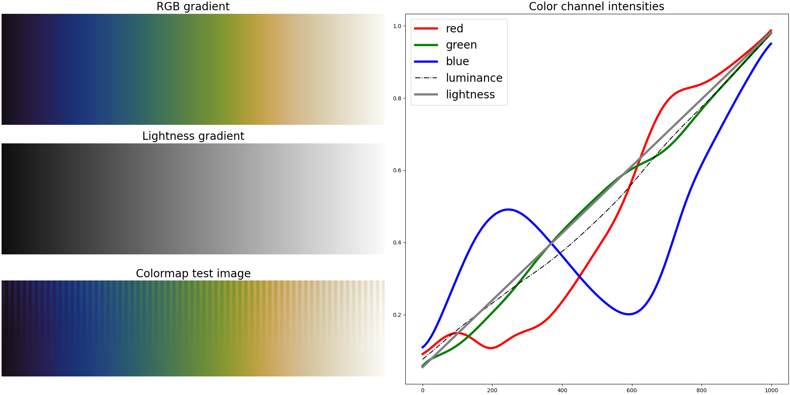
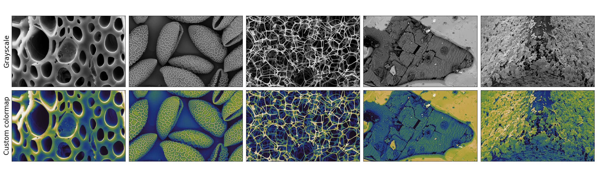
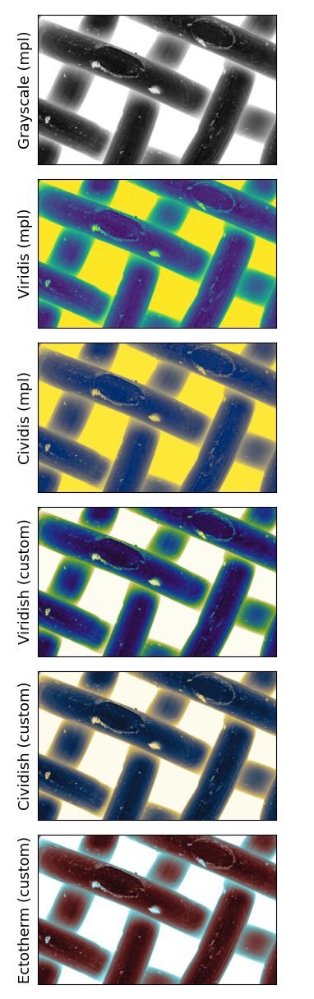
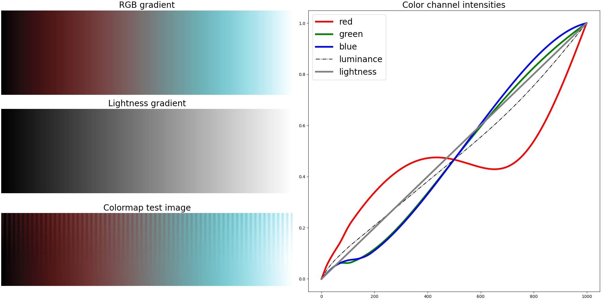
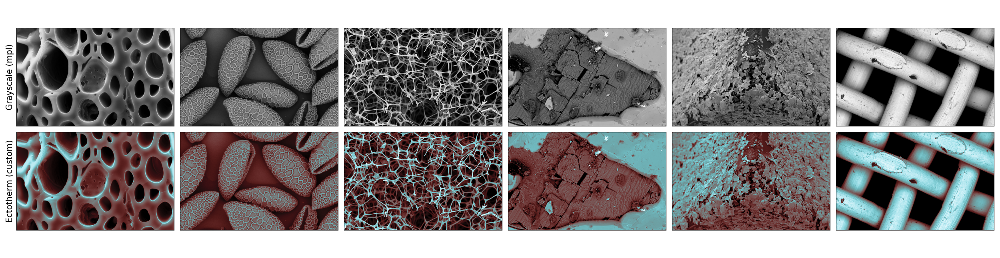
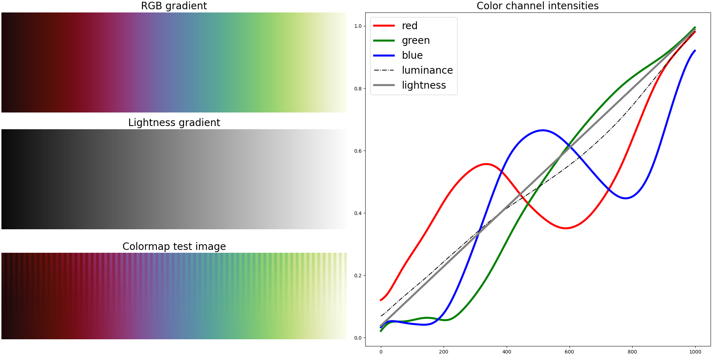
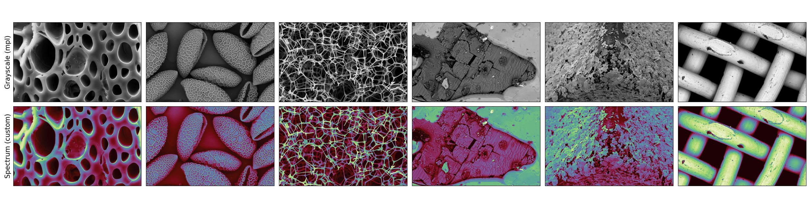

# perfect-cmaps
This package provides Python functionality for creating custom colormaps which are perfectly perceptually uniform.
The project came up as a result of there being too few easily accessible perceptually uniform colormaps, so I wanted to have a go at creating a good library where users can easily create their own. I wasn't quite happy with colormaps such as `viridis`, `plasma` or `magma` from `matplotlib`, so I started making some algorithmic colormaps. 

To stay as true as possible to the lightness achieved by a true grayscale colormap, but add more information with colors, the perceptual range of colormaps is optimized to be as high as possible.

### Main package functionality
- `create_cmap()`: Create your own colormap.
- `get_cmap()`: Get a named colormap from the library -- an instance of `matplotlib.colors.LinearSegmentedColormap`.
- `list_cmaps()`: Lists all available local and internal colormaps.
- `compare_cmaps()`: Plots a comparison of colormaps by name, or of all available colormaps if no names are given.
- `plot_cmap()`: Plots a single colormap (or colormap name) with its lightness profile, a test image and its color channels.

### Example of creating a custom colormap
run: `python ./perfect_cmaps/customize_cmap.py --num_points 21 --lightness linear` or a similar command

This specifies that your colormap will have 21 control points, which will later be interpolated for desired granularity, and that the colormap will have a linear lightness profile. 

In the window, you choose one color per lightness level:
- **Click** to choose a color. Clicks outside the gamut are pulled onto its boundary, keeping the hue.
- **Right-click** or **Backspace** to undo the last color.
- **V** to switch between the plain a\*b\* plane and a view where each gamut slice is stretched to fill the square. The stretched view keeps the hue angle, and the distance from the center is the chroma relative to the most saturated color of that hue, which makes the small slices near black and white easier to work with. Start in it with `--view square`.
- **Esc** to quit without saving.

When all colors are chosen, the final colormap is shown, and you can name it and save it.

https://github.com/user-attachments/assets/83e53b18-62d8-4003-b7ef-ad37042df294

You can also change the view to a square-transformed version of the CIELAB gamut slices, which can make it easier to place control points:

https://github.com/user-attachments/assets/c8f72af1-411e-49bf-8fb5-7bbd9b85efd3

### Generated colormap
To test out your colormap, you can use the function `get_cmap()` or use the main function from `colormaps.py`:

`python ./perfect_cmaps/colormaps.py --colormap test_colormap -n 1000 --interpolation quadratic --smoothing 0.03`

```
import perfect_cmaps as pcm
cmap = pcm.get_cmap("test_colormap", n=1000, interpolation="quadratic", smoothing=0.03)
pcm.plot_cmap(cmap)
```
Here we specify to use a colormap called `test_colormap` and create the colormap with 1000 points, with quadratic interpolation and some amount of smoothing applied. 



### Test images 


Here's a compilation of some colormaps generated with this library, compared with some standard colormaps available in `matplotlib`:


The top two colormaps, `viridis` and `cividis` have a lower perceptual range, and thus look less clear -- almost like there's a filter on them. The colormaps generated with `perfect-cmaps` are crisper and offer a maximal perceptual range. Additionally, the perceptual limitation for the standard colormaps is especially visible when for example a background in grayscale is very white, in which case the standard colormaps are in this case yellow and clearly do not cover the entire lightness spectrum.



The algorithmically created `ectotherm` colormap in fact covers 100 % of the perceptual range, while adding more information through colors. It ranges from completely black to completely white, while adding colors in between and maintaining truly linearly increasing lightness. This is one of my favorites! The other two displayed custom colormaps mimic `viridis` and `cividis`, but with a higher perceptual range. The standard `ectotherm` colormap is linear in luminance, whereas the `ectotherm_l` colormap is linear in lightness. I recommend the `ectotherm_l` colormap for general use.




You may have heard that standard RGB colormaps should be avoided. Well, common RGB colormaps are indeed not at all perceptually uniform, but if you design them right, you can still have a useful colormap with much color information, perceptual range and true perceptual uniformity.




Thanks to *Nanoscience.com* for letting me use the grayscale images as examples! Find them at https://www.nanoscience.com/techniques/scanning-electron-microscopy/.

These custom generated colormaps are theoretically perceptually uniform, but note that some screen settings may show colormap artifacts, making the colormaps appear less perceptually uniform. This may happen at lower computer screen lighting, for example.
